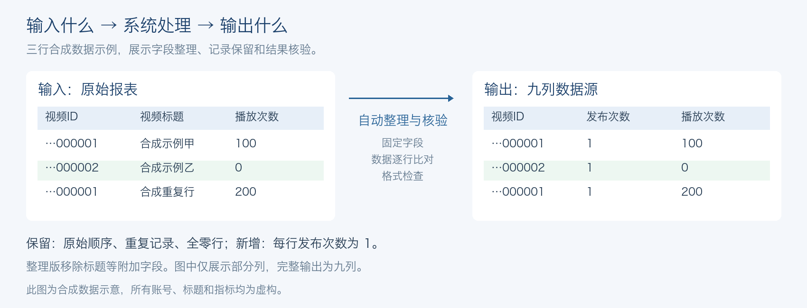

# 运营报表自动化

**AI 应用 / 运营提效项目**

将生意经报表下载、Excel 整理与核验、公司盘交付串成定时工作流，让门店查看自己的数据。

[**查看飞书一页介绍 ↗**](https://my.feishu.cn/wiki/PNBqwLeyriJtiBkpQircS1XmnKc)

## 我的贡献

- **把业务说清楚：** 定义日期、字段和模板规则，提供手工样表验收。
- **让方案更实用：** 发现逐屏操作耗时过长，推动固定步骤改成可复用脚本。
- **让结果可核对：** 借助 Codex 完成开发与迭代，检查数据、格式和上传结果。

<strong>看一个处理前后的例子</strong>

以上全部为合成数据；整理版固定九列，保留全零行、重复记录和原始顺序。

代码与运行方法

[运行与配置说明](docs/usage.md) · [源代码](src/report_delivery) · [自动测试](https://github.com/jaden20030518-lgtm/ops-report-delivery/actions)

公开代码提供脱敏的整理、核验、可配置交付与模拟演示；完整业务流程的运行证据见飞书介绍。

约2,000家门店实际使用及原流程约30分钟为本人确认；58,611行和约9分10秒来自2026-09-28一次真实运行，含平台等待。这里展示单次结果。
