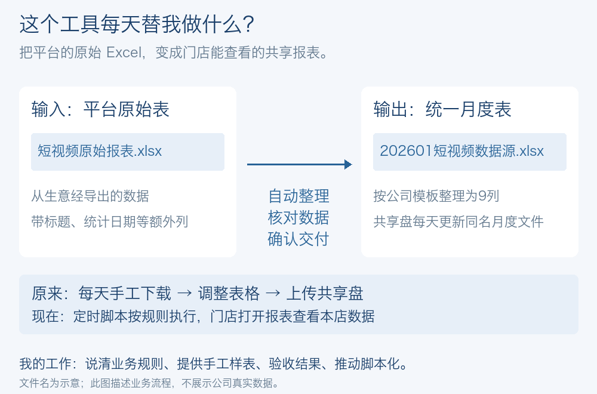

# 门店短视频日报自动更新

**每天重复的“下载表、改表、上传表”，交给脚本做。**

输入是生意经导出的短视频原始 Excel，包含播放、成交、核销数据；输出是共享盘中按公司模板整理好的月度报表，门店用它查看本店数据。

[**查看飞书一页介绍 ↗**](https://my.feishu.cn/wiki/PNBqwLeyriJtiBkpQircS1XmnKc)

## 我负责的部分

- **定规则：** 哪段日期、哪些指标、表格长什么样、交到哪里。
- **验结果：** 用自己的手工样表检查数据、列顺序和格式。
- **改方案：** 发现 AI 逐屏操作太慢，要求固定步骤改用脚本；Codex 辅助实现。

**实际使用场景：约2,000家门店查看本店数据。** 一次真实运行完成58,611行数据核验与上传，从任务创建到确认上传约9分10秒；原手工流程总体约30分钟。

<strong>看一个处理前后的例子</strong>

以上全部为合成数据；整理版固定九列，保留全零行、重复记录和原始顺序。

代码与运行方法

[运行与配置说明](docs/usage.md) · [源代码](src/report_delivery) · [自动测试](https://github.com/jaden20030518-lgtm/ops-report-delivery/actions)

公开代码提供脱敏的整理、核验、可配置交付与模拟演示；完整业务流程的运行证据见飞书介绍。

约2,000家门店实际使用及原流程约30分钟为本人确认；58,611行和约9分10秒来自2026-09-28一次真实运行，含平台等待。这里展示单次结果。
